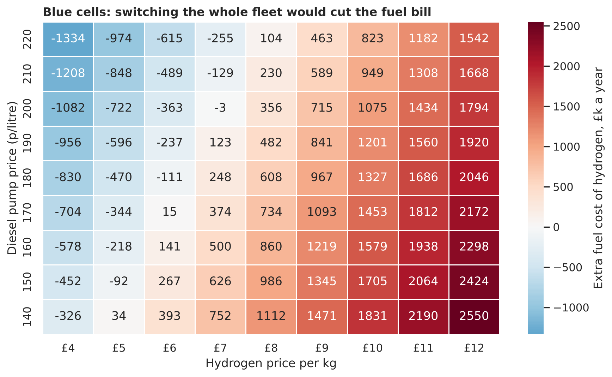
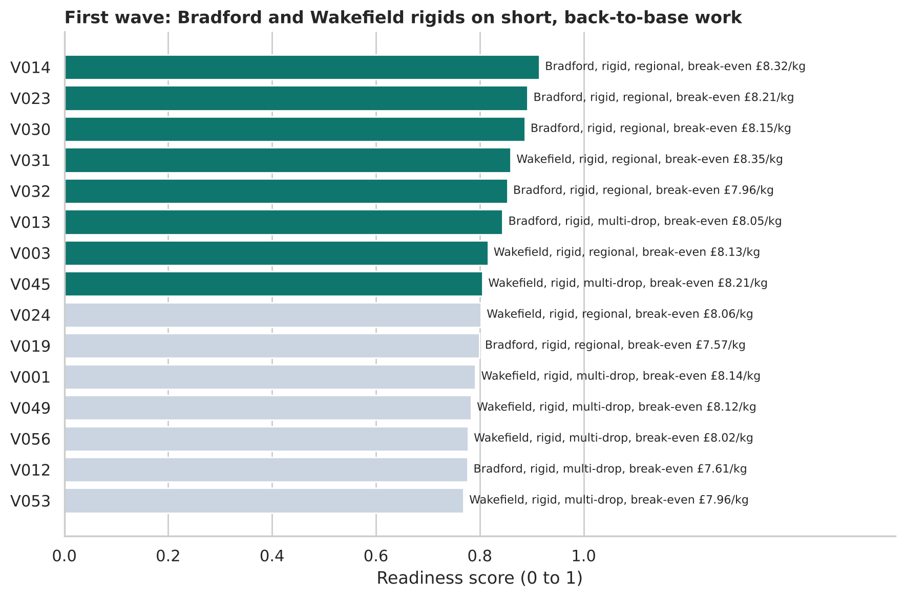
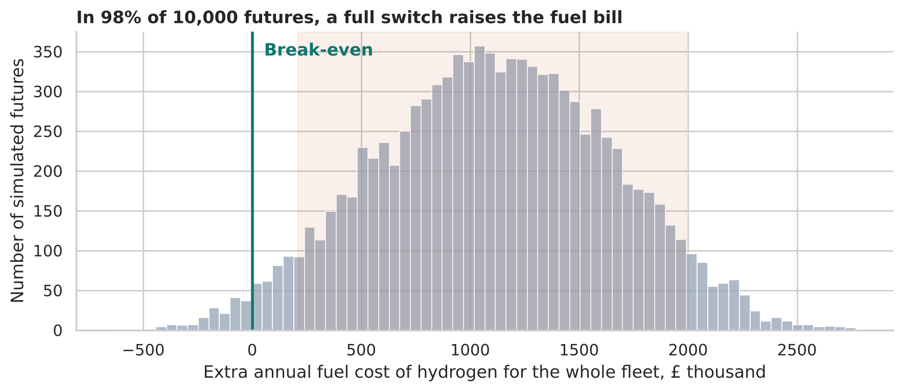
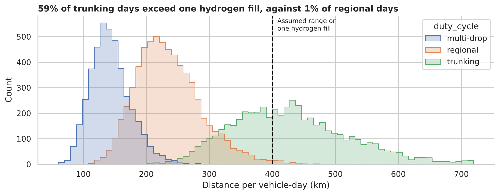

# HyFleet: hydrogen readiness analytics for a UK SME haulier

Which trucks in a 60-vehicle diesel fleet should switch to hydrogen first, and what would hydrogen have to cost for the switch to pay?

This project answers that question end to end: messy telematics data, a logged cleaning pipeline, SQL analysis, exploratory charts, a break-even model, a 10,000-run Monte Carlo simulation and a weighted vehicle readiness ranking.

**Stack:** Python, pandas, NumPy, SQL (SQLite), Matplotlib, Seaborn.

> **Data note.** The company and its data are simulated. The simulation is calibrated to published UK figures (see [Data and assumptions](#data-and-assumptions)), so the patterns behave like real fleet data.



## Key findings

| # | Finding |
|---|---|
| 1 | At 196.8p diesel and £10/kg hydrogen, switching the whole fleet would add about **£1.1m a year** in fuel. The fleet breaks even at about **£6.90/kg**. |
| 2 | Across 10,000 simulated price futures, hydrogen is cheaper for the whole fleet in **only about 2%**. |
| 3 | The best first candidates are **eight Bradford and Wakefield rigids on regional work**: almost every day fits one fill, they end at base, and their depots are near a station. They emit 378 t CO2e a year. |
| 4 | Trunking artics burn the most diesel, but **59% of their days exceed one fill**. They are a later-stage option. |
| 5 | If diesel falls back to 150p, hydrogen must reach about **£5.30/kg** to break even. The business case depends on diesel staying high. |



## Method

1. **Simulate** a year of duty data (about 16,000 vehicle-days) with realistic data-quality problems: inconsistent text, two date formats, mixed units, duplicates, decimal-slip outliers and gaps.
2. **Profile** the raw data and log every issue before changing anything.
3. **Clean** it in eight logged, assertion-checked steps (see `data/clean/cleaning_log.csv`). Outliers are found with a 3 × IQR rule on litres per 100 km; gaps are filled from each vehicle's own median and flagged.
4. **Query** the clean tables in SQLite with joins, CASE banding, CTEs, window functions and date logic, then **cross-check** the results in pandas.
5. **Profile** each vehicle: annual km, daily distance, fuel rate, cost, CO2e, range fit and back-to-base share.
6. **Model** a fuel-cost break-even price per truck, a fleet sensitivity grid built with NumPy broadcasting, and a Monte Carlo simulation of diesel price, hydrogen price and hydrogen use.
7. **Rank** trucks with a weighted readiness score, then test the weights.

| Monte Carlo: fleet cost gap across 10,000 futures | Range fit by duty cycle |
|---|---|
|  |  |

## Skills demonstrated

| Area | Techniques |
|---|---|
| **pandas** | Profiling, string cleaning, explicit date parsing, unit conversion, de-duplication, IQR outliers, group-wise imputation with `transform`, validated merges, named aggregation, `pivot_table`, `resample` |
| **NumPy** | Vectorised maths, boolean masks, `np.where`, broadcasting for scenario grids, `np.interp`, `np.polyfit`, seeded random generators, Monte Carlo on a 10,000 × 60 array, percentiles |
| **SQL** | Joins, `GROUP BY` / `HAVING`, `CASE`, CTEs, `RANK` and windowed `SUM`, SQLite date functions, row-count checks after joins |
| **Visualisation** | Matplotlib figure/axes model, annotations, shared-axis subplots, formatters; Seaborn histograms, box plots, regression plots, heatmaps and small multiples; finding-led titles |
| **Practice** | Data-quality log, assertions, SQL vs pandas reconciliation, sourced assumptions, sensitivity testing, stated limitations, reproducible seeded pipeline |

## Repository structure

```
├── data/
│   ├── raw/          # simulated, deliberately messy CSVs (from src/generate_data.py)
│   └── clean/        # cleaned tables, cleaning log, vehicle profile
├── figures/          # all charts, 200 dpi
├── notebooks/
│   └── hyfleet_analysis.ipynb   # the full analysis, with outputs
├── sql/queries.sql   # every SQL query
├── src/generate_data.py
└── requirements.txt
```

## How to run

```bash
python -m venv .venv
source .venv/bin/activate          # Windows: .venv\Scripts\activate
pip install -r requirements.txt
jupyter lab notebooks/hyfleet_analysis.ipynb
```

Run all cells. The notebook regenerates the data and the SQLite database (`data/fleet.db`). Everything is seeded, so the results reproduce exactly.

## Data and assumptions

| Input | Value | Source |
|---|---|---|
| Diesel use, artic and rigid | about 7.9 and 9.1 mpg | DfT road freight statistics |
| Diesel pump price | 141p to 200p over the year; 196.8p base | UK Government weekly road fuel prices (week to 16 Nov 2026) |
| VAT on diesel | 20%, reclaimed | Applies to VAT-registered hauliers |
| Hydrogen price | £10/kg base, £6 to £12 range | Modelled 2026 contracted depot price of £9.5 to £10.5/kg (Harper, 2026) |
| Hydrogen use | 9.0 kg/100km artic, 6.5 kg/100km rigid | Assumption, from industry reports of 30 to 50 kg for 300 to 500 km |
| Hydrogen range per fill | 400 km | Assumption |
| Diesel CO2e | 2.55 kg per litre | DESNZ greenhouse gas conversion factors |

## Limitations

* Simulated data: realistic patterns, invented company.
* Fuel cost only: no vehicle price premium, grants, maintenance or residual value.
* Tailpipe CO2e only: hydrogen's real footprint depends on how it is produced.
* Fixed 400 km range per fill; real range varies with load, weather and terrain.
* Readiness weights are a reasoned judgement; an alternative weighting leaves the shortlist unchanged.

## Next steps

* Replace the simulation with real DfT vehicle licensing and road freight tables.
* Add battery-electric trucks and a full total cost of ownership model.
* Publish the model as an interactive dashboard.

## Author

**Samiur Rahman**, DBA candidate, University of Gloucestershire. Doctoral research: SME readiness for hydrogen HGV adoption in UK freight.

Code released under the MIT licence.
